# Kochevnik Store

[](https://github.com/asas-poq/Kochevnik-Store/actions/workflows/ci.yml)
[](LICENSE)


Интернет-магазин кашемира и кожи: REST API на FastAPI, витрина и админка на Next.js, оплата через СБП (ЮKassa), уведомления в Telegram, мониторинг в Prometheus и Grafana. Весь стек поднимается одной командой через Docker Compose.

**Документация API без запуска проекта:** [asas-poq.github.io/Kochevnik-Store/api](https://asas-poq.github.io/Kochevnik-Store/api/)

## Обо мне и проекте

Я backend-разработчик, этот проект сделан как моё backend-портфолио.

| Часть | Как сделана |
|---|---|
| Бэкенд: API, модель данных, миграции, логика заказов и оплаты, воркер, парсер, тесты | Написан мной |
| Инфраструктура: Docker Compose, nginx, Prometheus, Grafana, CI | Настроена мной |
| Дизайн витрины | Макеты пяти экранов (главная, каталог, карточка товара, корзина, оформление) я нарисовал в [Figma](https://www.figma.com/design/SdLZRSgUdizjPyxh0Rj6v7/Untitled?node-id=0-1) |
| Фронтенд | Сгенерирован с помощью ИИ по моим макетам, к API его подключал я |

Вся основная работа и инженерные решения находятся в бэкенде. Фронтенд нужен, чтобы показать API в действии.

## Скриншоты

| Главная | Каталог |
|---|---|
|  | 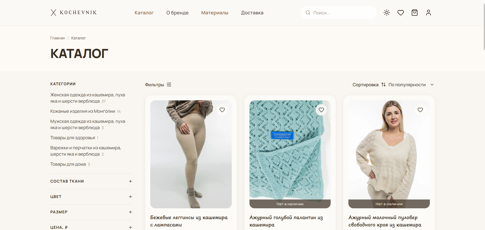 |

| Карточка товара | Корзина |
|---|---|
| 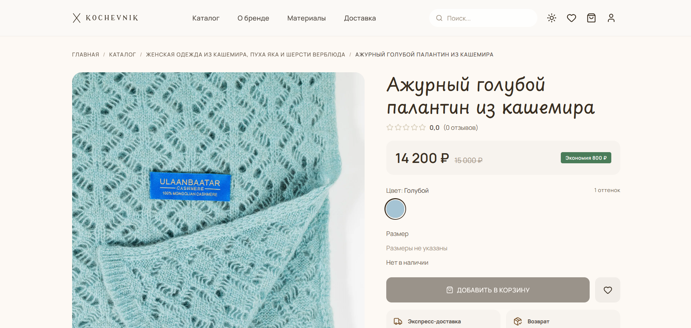 | 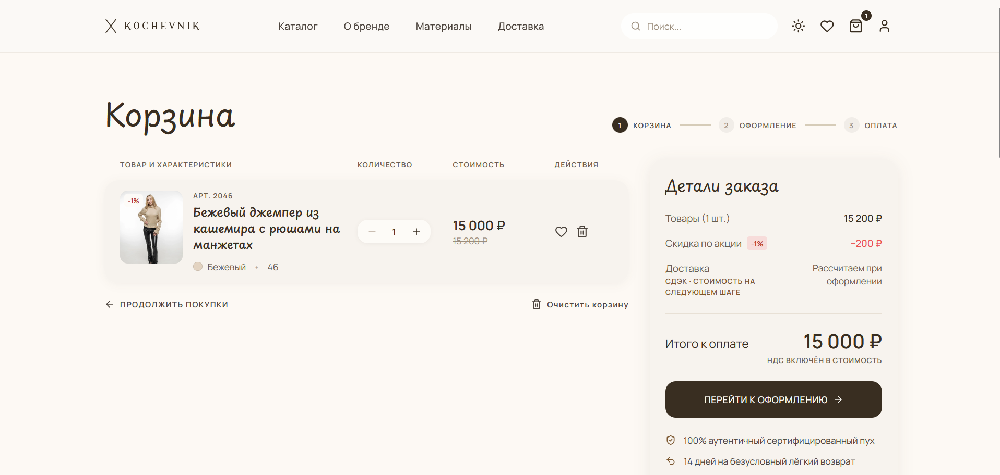 |

| Оформление заказа | Оплата в песочнице |
|---|---|
| 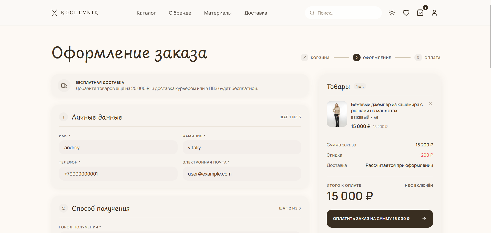 | 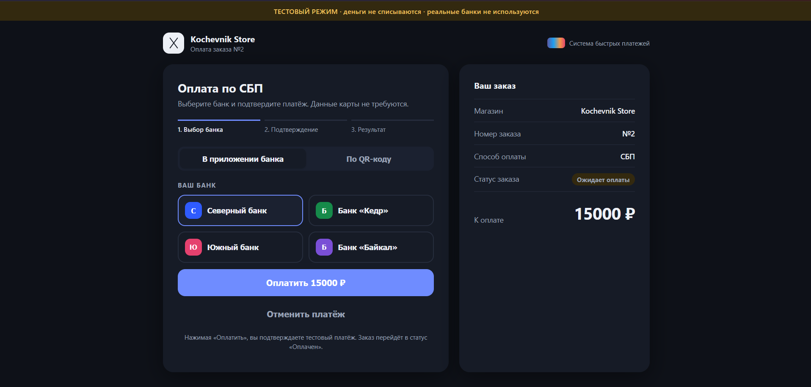 |

### Админка и уведомления

| Заказы в админке | Уведомление в Telegram |
|---|---|
| 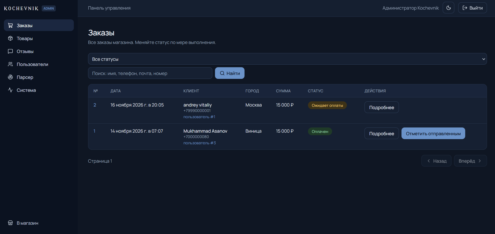 | 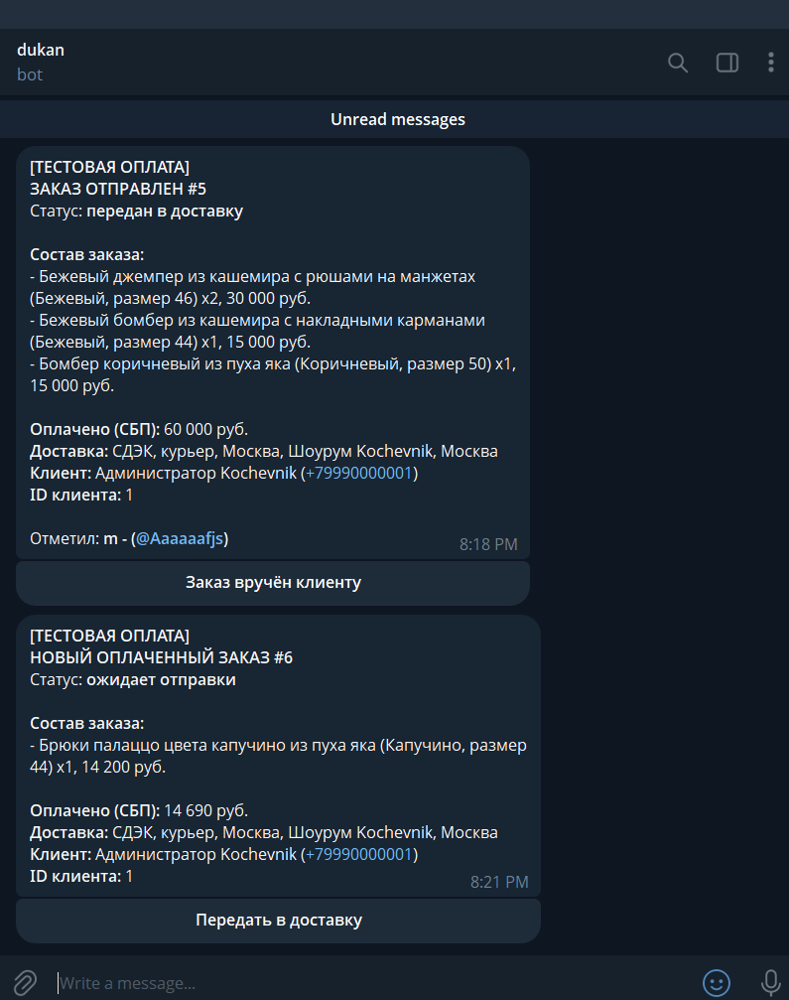 |
### Бэкенд и инфраструктура

| Swagger (`/docs`) | SQLAdmin (`/sqladmin`) |
|---|---|
| 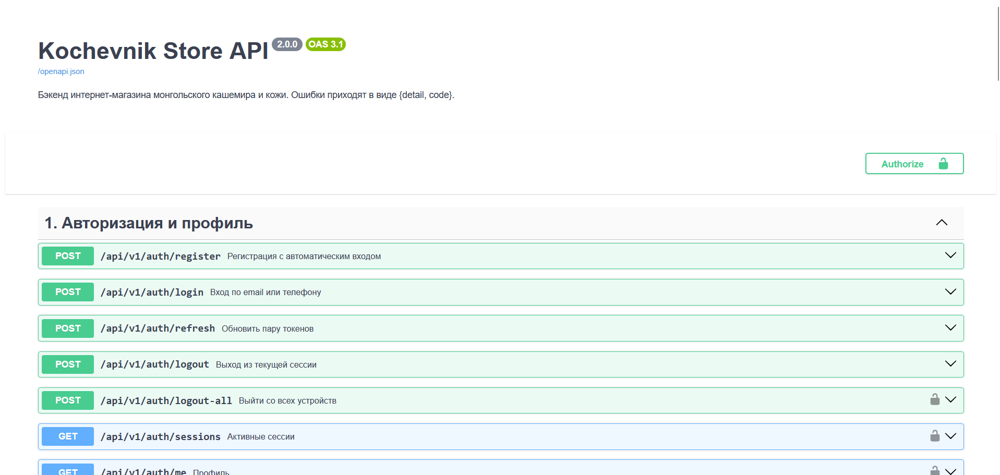 | 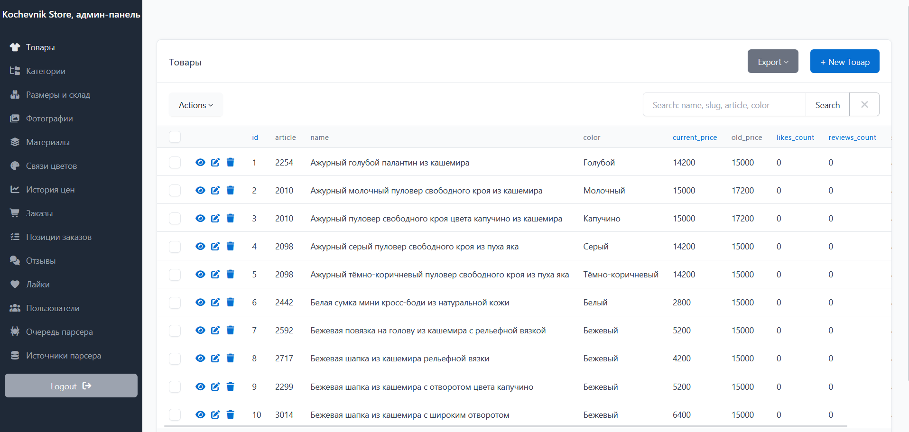 |


| Контейнеры (`docker compose ps`) | Мониторинг: Grafana (`:3001`) |
|---|---|
| 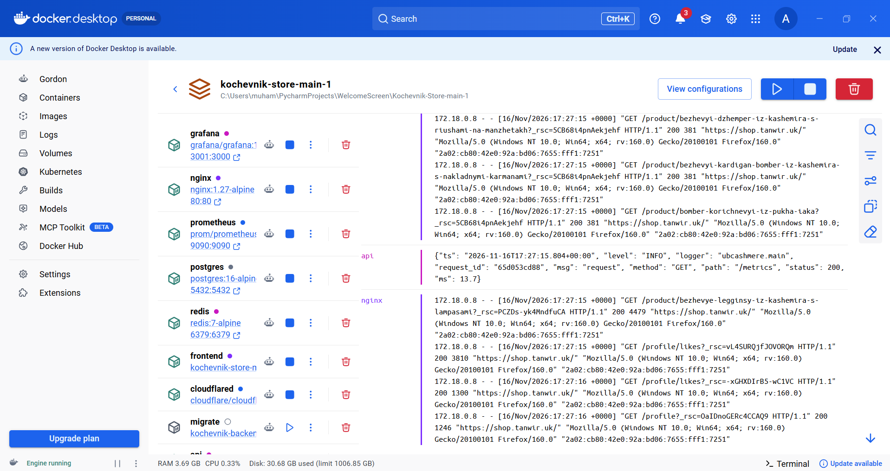 | 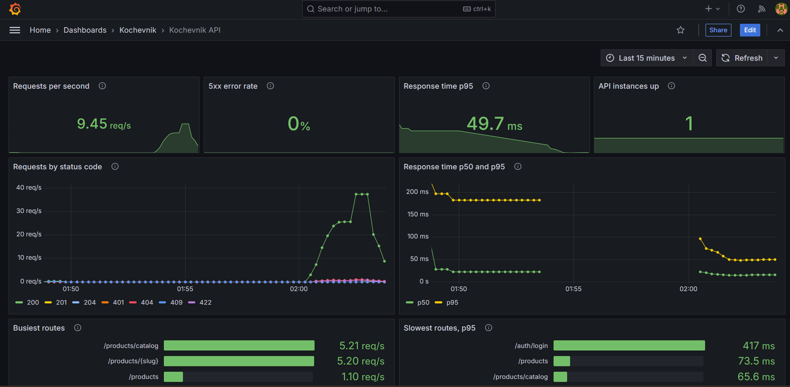 |
## Возможности

Покупатель: каталог с фильтрами по категории, материалу, цвету, размеру и цене, поиск, сортировка по популярности и скидке, карточка товара с остатками по размерам, отзывы, избранное, корзина, оформление и оплата через СБП, личный кабинет с историей заказов.

Владелец: редактор товаров с загрузкой фото, управление заказами, пользователи, модерация отзывов, запуск парсера, состояние сервисов. Новые заказы приходят в Telegram, статус меняется кнопками прямо в чате.

## Архитектура


| Слой | Технологии |
|---|---|
| API | Python 3.11, FastAPI, SQLAlchemy 2.0 (async), Pydantic v2, Alembic |
| Хранилища | PostgreSQL 16, Redis 7 |
| Фоновые задачи | ARQ (парсер, автоотмена заказов, Telegram) |
| Админ-панель | SQLAdmin и собственная админка во фронтенде |
| Витрина | Next.js 16, React 19, TypeScript, Tailwind 4, shadcn/ui, TanStack Query, zustand |
| Инфраструктура | Docker Compose, nginx, Prometheus, Grafana, GitHub Actions |

Браузер работает с одним адресом: nginx направляет `/api`, `/media`, `/docs`, `/sqladmin` в FastAPI, остальные запросы во фронтенд. Из-за этого CORS при локальном запуске не используется.

## Технические решения

**Резервирование остатков.** Заказ списывает остаток сразу, под блокировкой строк размеров (`SELECT ... FOR UPDATE`). Строки блокируются в фиксированном порядке, поэтому два заказа с общими позициями не создают взаимную блокировку.

**Автоотмена.** Неоплаченный заказ отменяется воркером через 30 минут, остаток возвращается на склад.

**Явная машина статусов.** Допустимые переходы заданы таблицей, всё остальное отклоняется. Повторные вебхуки и гонки не откатывают статус.


**Идемпотентные вебхуки оплаты.** Каждое событие записывается в `payment_events`, повторная доставка возвращает `duplicate` и ничего не меняет. В боевом режиме статус и сумма платежа запрашиваются у ЮKassa, а не берутся из тела вебхука. Оплата по уже отменённому заказу не применяется автоматически и уходит владельцу на ручной разбор.


**Безопасность.** Access и refresh токены с привязкой к сессии, ограничение частоты запросов через Redis, чужой заказ возвращает 404 вместо 403. В режиме `production` сервер не стартует со слабыми секретами и тестовыми ключами, песочница платежей отключается.

**Наблюдаемость.** Метрики Prometheus, дашборд Grafana, структурированные логи, `/health` с проверкой БД, Redis, S3 и Telegram.

## Запуск

Требуется Docker с Compose 2.23 или новее.

```bash
git clone https://github.com/asas-poq/Kochevnik-Store.git
cd Kochevnik-Store

cp backend/.env.example backend/.env
docker compose up -d --build
make seed    # то же: docker compose run --rm worker python -m scripts.seed_from_parser
```

Миграции применяются автоматически перед стартом API. Команда `make seed` создаёт двух пользователей, запускает парсер и загружает в каталог 50 товаров. Это занимает несколько минут, потому что парсер делает паузы между запросами:

| Роль | Почта | Пароль |
|---|---|---|
| Администратор | admin@example.com | Admin123! |
| Покупатель | anna@example.com | Customer123! |

| Сервис | Адрес |
|---|---|
| Магазин | http://localhost |
| Админка магазина | http://localhost/admin |
| Документация API (Swagger) | http://localhost/docs |
| База данных (SQLAdmin) | http://localhost/sqladmin |
| Grafana | http://localhost:3001 (логин `admin`, пароль из `GRAFANA_PASSWORD`) |
| Prometheus | http://localhost:9090 |

Оплата работает в песочнице: после оформления заказа открывается тестовая страница, на которой платёж подтверждается или отклоняется. Без токена Telegram-бота уведомления пишутся в лог воркера.

Остановка: `docker compose down`. Вместе с данными: `docker compose down -v`.

Если порт 80 занят, измените `"80:80"` в `docker-compose.yml`, задайте `SITE_URL=http://localhost:8080` в `backend/.env` и пересоберите фронтенд: `docker compose up -d --build frontend`. Переменные `NEXT_PUBLIC_*` встраиваются в сборку, поэтому после изменения адреса фронтенд пересобирается всегда.

## Тесты и CI

```bash
make test    # pytest
make lint    # ruff
```

GitHub Actions при каждом коммите запускает линтер и тесты бэкенда, ESLint и production-сборку фронтенда, а также сборку Docker-образов.

Тесты бэкенда покрывают авторизацию и сессии, каталог, заказы и остатки, вебхуки оплаты, ограничение частоты, отзывы, парсер и соответствие миграций моделям. Подробности в [backend/README.md](backend/README.md).

## Структура репозитория

```
backend/      API, миграции, воркер, парсер, тесты
frontend/     Next.js приложение
docs/         страница-презентация, схема архитектуры, скриншоты, статическая копия Swagger
docker-compose.yml
Makefile
```

Подробнее: [backend/README.md](backend/README.md), [frontend/README.md](frontend/README.md).

## Публикация в интернете

Для публичной демонстрации необходимо:

1. Задать `ENVIRONMENT=production` в `backend/.env`. В этом режиме ручки песочницы отключены, слабые секреты блокируют запуск.
2. Сгенерировать собственные `SECRET_KEY` и `PAYMENT_WEBHOOK_SECRET`, например `openssl rand -hex 32`.
3. Указать боевые ключи ЮKassa.
4. Сменить `POSTGRES_PASSWORD` и `GRAFANA_PASSWORD`.
5. Настроить HTTPS перед nginx.
6. Ограничить доступ к `/docs`, `/openapi.json` и `/sqladmin`.

Для пункта 6 в блоке `configs` файла `docker-compose.yml` замените проксирование на `return 404;` либо разрешите доступ только с вашего адреса:

```nginx
location /docs {
  allow 203.0.113.10;
  deny all;
  proxy_pass http://api;
}
location /openapi.json {
  allow 203.0.113.10;
  deny all;
  proxy_pass http://api;
}
```

`/docs` и `/openapi.json` закрываются вместе, иначе Swagger откроется без схемы. Фронтенд эти адреса не использует, у него собственная копия `openapi.json`. После изменения конфигурации: `docker compose up -d --force-recreate nginx`.

## Парсер

Модуль `backend/app/services/parser` демонстрирует асинхронный сбор данных: httpx, BeautifulSoup, учёт robots.txt, паузы между запросами, повторы с нарастающей задержкой, состояние и блокировка в Redis. Каталог для демонстрации заполняется этим парсером командой `make seed`: он берёт 50 товаров с ubcashmere.ru, соблюдая robots.txt. Фото и описания принадлежат владельцу магазина, проект их не использует в коммерческих целях. Парсер допустимо направлять только на источники, которые разрешают автоматический сбор данных.

## Лицензия

[MIT](LICENSE)
