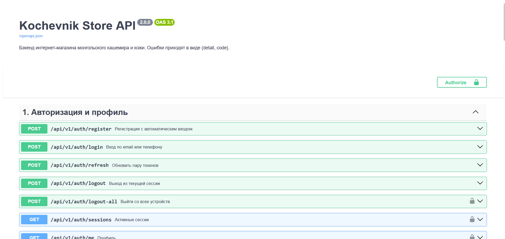
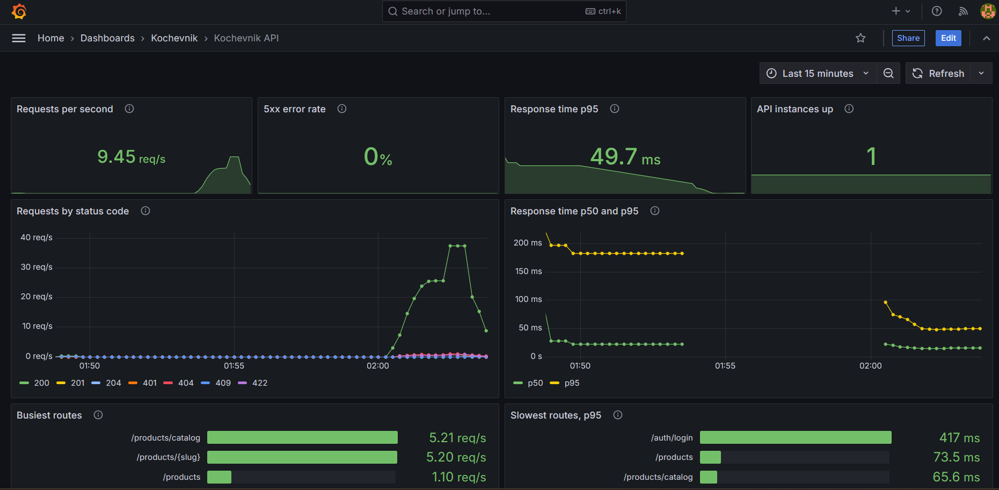

# Kochevnik Store: бэкенд

REST API интернет-магазина: FastAPI, SQLAlchemy 2.0 (async), PostgreSQL, Redis. Фоновые задачи выполняет ARQ: автоотмена неоплаченных заказов, парсер и Telegram-бот.

Интерактивная документация доступна на `/docs`, панель администрирования базы на `/sqladmin`. Статическая копия схемы API без запуска проекта: [asas-poq.github.io/Kochevnik-Store/api](https://asas-poq.github.io/Kochevnik-Store/api/).



## Структура

```
app/
  api/v1/       ручки: auth, products, categories, orders, interactions, payments, parser
  core/         конфигурация, безопасность, кэш, очередь, лимиты, логирование, ошибки
  db/           сессия, базовая модель, типы
  models/       модели SQLAlchemy
  schemas/      схемы Pydantic
  services/     бизнес-логика: заказы, оплата, каталог, отзывы, Telegram, S3, парсер
  admin/        представления SQLAdmin
  worker.py     задачи ARQ
alembic/        миграции
scripts/        seed_from_parser.py: демо-пользователи и загрузка 50 товаров парсером
monitoring/     конфигурация Prometheus и дашборд Grafana
tests/          pytest
```

Ручки тонкие и только разбирают запрос. Правила предметной области находятся в `services/`, что позволяет тестировать их без HTTP.

## Локальная разработка

Требуются Python 3.11, PostgreSQL и Redis. Инфраструктуру можно взять из Compose:

```bash
docker compose up -d postgres redis    # из корня репозитория

cd backend
pip install -r requirements-dev.txt
cp .env.example .env
alembic upgrade head
python -m scripts.seed_from_parser
uvicorn app.main:app --reload
```

Значения `.env.example` совпадают с параметрами базы из Compose.

## Тесты и линтер

```bash
pytest -q
ruff check . && ruff format --check .
```

Тесты выполняются на SQLite и fakeredis и не требуют внешних сервисов. Они проверяют авторизацию и сессии, каталог, заказы и остатки, вебхуки оплаты, ограничение частоты, отзывы, парсер, а также то, что миграции соответствуют моделям.

Ограничения тестового окружения: SQLite игнорирует `SELECT ... FOR UPDATE`, поэтому защита от одновременной покупки последней единицы товара проверяется только на PostgreSQL. Регистронезависимый поиск по кириллице также зависит от СУБД.


## Конфигурация

Полный список параметров с описаниями находится в `.env.example` и соответствует `app/core/config.py`. Основные:

| Параметр | Назначение |
|---|---|
| `ENVIRONMENT` | `development`, `test` или `production`. В `production` сервер не стартует со слабыми секретами и тестовыми ключами ЮKassa |
| `SECRET_KEY` | Подпись JWT и сессии SQLAdmin. Смена секрета завершает все сессии |
| `DATABASE_URL` | Полный адрес БД, перекрывает отдельные `POSTGRES_*` |
| `YOOKASSA_SHOP_ID` | Префикс `test_` включает песочницу без реальных платежей |
| `PAYMENT_WEBHOOK_SECRET` | Секрет вебхука в песочнице |
| `ORDER_PAYMENT_TTL_MINUTES` | Срок ожидания оплаты до автоотмены |
| `TELEGRAM_BOT_TOKEN` | Пустое значение включает демо-режим: сообщения пишутся в лог |
| `CORS_ORIGINS` | JSON-список адресов фронтенда |
| `METRICS_TOKEN` | Если задан, `/metrics` требует заголовок `Authorization: Bearer` |

За обратным прокси ограничению частоты нужен реальный IP клиента. В Compose это обеспечивает `FORWARDED_ALLOW_IPS`; при использовании другого прокси необходимо указать его адрес.

## Миграции

Схемой управляет Alembic, `create_all` при старте не вызывается.

```bash
alembic revision --autogenerate -m "описание изменения"
alembic upgrade head
```

Тест `tests/test_migrations.py` сравнивает результат миграций с моделями и падает при расхождении.

## Заказы и оплата

**Создание заказа.** Остаток резервируется сразу под блокировкой строк размеров. Запрос к платёжному шлюзу выполняется после коммита, поэтому блокировки на складе не удерживаются на время сетевого вызова. Если шлюз недоступен, заказ отменяется, остаток возвращается.

**Статусы.** `pending → paid → shipped → completed`, а также `pending → cancelled`. Допустимые переходы заданы таблицей в `services/orders.py`, любой другой переход отклоняется с ошибкой 409.

**Автоотмена.** Воркер отменяет заказы, не оплаченные за `ORDER_PAYMENT_TTL_MINUTES`, и возвращает остатки.

**Вебхук** `POST /api/v1/payments/webhook` идемпотентен. События фиксируются в `payment_events`, повторная доставка возвращает `duplicate`. В боевом режиме статус и сумма запрашиваются у ЮKassa. Результаты обработки:

| Ответ | Значение |
|---|---|
| `paid` | заказ переведён в оплаченные |
| `already_paid` | повторное событие |
| `cancelled`, `already_cancelled` | платёж отклонён |
| `paid_after_cancel` | оплата по отменённому заказу, нужен ручной разбор, владельцу уходит уведомление |
| `duplicate`, `ignored` | событие уже обработано или не требует действий |

**Песочница.** Тестовая страница оплаты доступна на `/api/v1/payments/sandbox/checkout/{order_id}`. В режиме `development` ручка имитации платежа не требует авторизации, поэтому такой экземпляр нельзя публиковать в интернете. В `production` эти ручки отсутствуют.

## Парсер

Асинхронный сборщик данных на httpx и BeautifulSoup. Запускается воркером, состояние и блокировка хранятся в Redis, поэтому несколько экземпляров API не запускают задачу параллельно. Блокировка снимается автоматически через `PARSER_LOCK_TTL_SECONDS`.

Ручки `/api/v1/parser/*` доступны только администратору: `POST /discover` собирает ссылки в очередь, `POST /scrape` разбирает карточки, `GET /status` показывает состояние.

Запуск из консоли без очереди и блокировки:

```bash
docker compose run --rm worker python -m app.services.parser discover
docker compose run --rm worker python -m app.services.parser scrape --limit 20
```

Особенности данных. Источник сообщает только наличие размера, но не количество, поэтому новому размеру присваивается `PARSER_DEFAULT_STOCK`, а закончившемуся ноль. Остатки и идентификаторы размеров повторный обход не изменяет, так как на них ссылаются заказы. Цены товаров из парсера определяются источником, ручная правка будет перезаписана. Статус, изменённый администратором, парсер не трогает. Товар без цены создаётся черновиком.

Сид (`make seed`) создаёт демо-пользователей и запускает `discover` и `scrape --limit 50`, то есть наполняет каталог 50 товарами. Какие именно товары попадут в выборку, зависит от порядка ссылок в sitemap источника. Если источник недоступен или не отдал ни одной карточки, скрипт завершается с ошибкой.

## Администрирование и мониторинг

SQLAdmin доступен только пользователям с ролью `admin`. Заказы там только для чтения: статус меняется через API или Telegram, иначе нарушается резервирование остатков. Хеши паролей не отображаются.

`GET /health` проверяет БД, Redis, S3 и Telegram. Недоступность БД или Redis возвращает 503, S3 и Telegram отображаются справочно. Метрики Prometheus доступны на `/metrics` и через nginx наружу не публикуются.



## Поведение при отказе зависимостей

| Зависимость | Поведение системы |
|---|---|
| PostgreSQL | API возвращает 503 на `/health`, запросы к данным завершаются ошибкой |
| Redis | Кэш и ограничение частоты отключаются с предупреждением в логе, каталог работает медленнее. `/health` возвращает 503, ручки парсера недоступны, воркер не запускается |
| Worker | Задачи парсера остаются в статусе `queued`, неоплаченные заказы не отменяются, остатки остаются в резерве, кнопки Telegram не обрабатываются |
| S3 | Загрузка фото возвращает 502. В `development` и `test` фото сохраняются в `media/` |
| Платёжный шлюз | Создание заказа отменяется, остатки возвращаются, клиент получает 502 |
| Миграции | В Docker выполняются до старта API. Без миграций первый запрос к таблице завершается ошибкой 500 |
